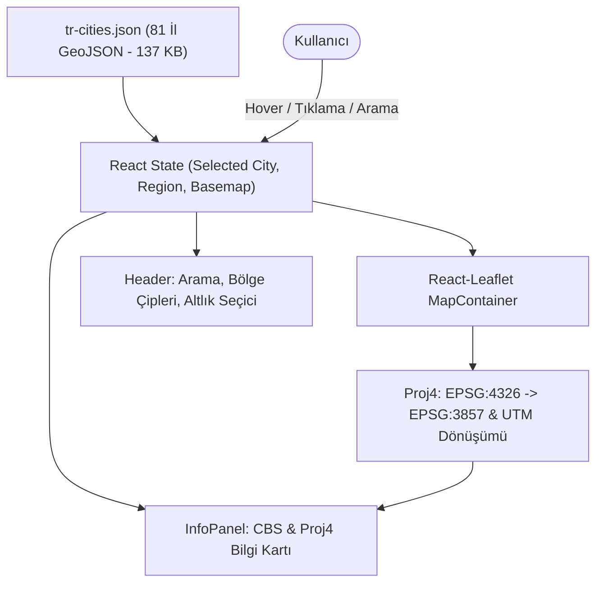

# 🗺️ Turkey Interactive GIS Map - 81 Provinces GeoJSON & Leaflet Explorer

[](https://reactjs.org/)
[](https://leafletjs.com/)
[](https://geojson.org/)
[](https://proj4js.org/)
[](https://yucel-gumus.github.io/turkey-map.github.io/)
[](https://www.yucelgumus.dev/)

> Türkiye'nin 81 ilinin coğrafi sınır poligonlarını **GeoJSON** formatında dinamik olarak harita üzerinde çizdiren, seçilen veya üzerine gelinen ili anlık olarak vurgulayan, il bazlı demografik ve coğrafi bilgi kartları sunan, **Proj4** ile harita projeksiyonu dönüşümlerini (WGS84, Web Mercator, UTM Dilimleri) gerçek zamanlı hesaplayan modern **React & Leaflet** CBS web uygulaması.

---

## 🌟 Öne Çıkan Özellikler

- 🇹🇷 **Eksiksiz & Optimize 81 İl Sınır Poligonları:** Koordinat hassasiyeti optimize edilerek boyutu %87 oranında küçültülmüş, zenginleştirilmiş (plaka kodu, bölge, ağırlık merkezi ve sınırlayıcı kutu verilerini içeren) hafif GeoJSON veri seti.
- 🔍 **Akıllı Arama & Otomatik Tamamlama:** İl adı veya plaka koduyla (örn: `34`, `06`, `Trabzon`, `İzmir`) anında arama ve seçilen ile otomatik kamera odaklanması.
- 🧭 **7 Coğrafi Bölge Filtresi:** Marmara, Ege, Akdeniz, İç Anadolu, Karadeniz, Doğu Anadolu ve Güneydoğu Anadolu bölgelerine göre filtreleme ve tek tıkla bölgeye odaklanma (`fitBounds`).
- 🎨 **Çoklu Altlık Harita Seçici (Basemaps):** CartoDB Positron (Açık), OpenStreetMap (Standart), CartoDB Dark Matter (Karanlık) ve Esri World Imagery (Uydu) katmanları arasında kesintisiz geçiş.
- 📐 **Proj4 ile Gerçek Zamanlı Projeksiyon Dönüşümleri:** Seçilen ilin merkez koordinatları için anlık olarak WGS84 (EPSG:4326), Web Mercator (EPSG:3857) ve Türkiye'nin ilgili UTM dilimi (UTM 35N, 36N, 37N, 38N) koordinat hesaplamaları.
- 🎯 **İnteraktif Vurgulama & Hover Tooltip:** Fare ile il üzerine gelindiğinde akıcı parıltı efekti, özel Leaflet tooltip gösterimi ve tıklama ile detaylı CBS bilgi kartı.
- 📱 **Modern & Duyarlı (Glassmorphic) Arayüz:** Masaüstü, tablet ve mobil cihazlar için optimize edilmiş, saydam cam efektli şık kullanıcı arayüzü.

---

## 🏗️ Mimari & Coğrafi Veri Akışı



---

## 🚀 Hızlı Başlangıç

### Gereksinimler
- **Node.js**: v16.0 veya üstü
- **npm**: v8.0 veya üstü

### Kurulum

```bash
git clone https://github.com/yucel-gumus/turkey-map.github.io.git
cd turkey-map.github.io

npm install
```

### Yerel Ortamda Başlatma

```bash
npm start
```

Uygulama otomatik olarak `http://localhost:3000/turkey-map.github.io/` adresinde açılacaktır.

### Testleri Çalıştırma

```bash
npm test -- --watchAll=false
```

### Derleme (Production Build)

```bash
npm run build
```

### GitHub Pages'e Dağıtım (Deploy)

```bash
npm run deploy
```

---

## 📂 Proje Dizin Yapısı

```
turkey-map.github.io/
├── public/
│   ├── favicon.ico
│   ├── index.html                  # SEO & OpenGraph meta etiketleri yapılandırılmış şablon
│   └── manifest.json
├── src/
│   ├── components/
│   │   ├── Header.jsx              # Arama, bölge çipleri ve altlık menüsü
│   │   ├── InfoPanel.jsx           # Detaylı CBS ve Proj4 koordinat bilgi kartı
│   │   ├── MapController.jsx       # Leaflet kamera fitBounds / flyTo kontrolcüsü
│   │   └── FooterBadge.jsx         # Geliştirici ve teknoloji rozeti
│   ├── utils/
│   │   ├── gisUtils.js             # Proj4 dönüşümleri, bölge sınırları ve renk paleti
│   │   └── gisUtils.test.js        # CBS yardımcı fonksiyonlarının birim testleri
│   ├── tr-cities.json              # 81 İl optimize & zenginleştirilmiş GeoJSON
│   ├── turkey_geo.json             # Eşzamanlı GeoJSON poligon verisi
│   ├── App.js                      # Ana uygulama ve Leaflet katman yönetimi
│   ├── App.css                     # Modern CSS ve duyarlı tasarım stilleri
│   ├── App.test.js                 # Bileşen entegrasyon testleri
│   └── index.js                    # React kök bileşeni
├── package.json
└── README.md
```

---

## 🔗 Canlı Bağlantılar

* 🌐 **Canlı Demo:** [https://yucel-gumus.github.io/turkey-map.github.io/](https://yucel-gumus.github.io/turkey-map.github.io/)
* 💼 **Geliştirici Web Sitesi:** [yucelgumus.dev](https://www.yucelgumus.dev/)
* 🐙 **GitHub Profili:** [@yucel-gumus](https://github.com/yucel-gumus)

---

## 📄 Lisans

Bu proje [MIT Lisansı](LICENSE) ile lisanslanmıştır.